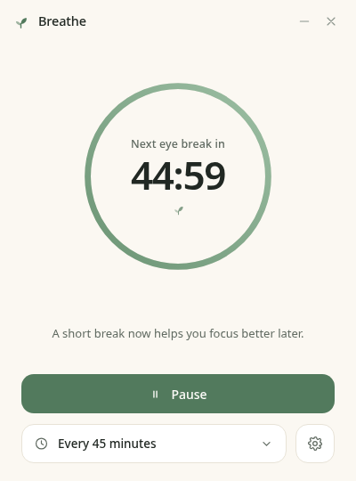
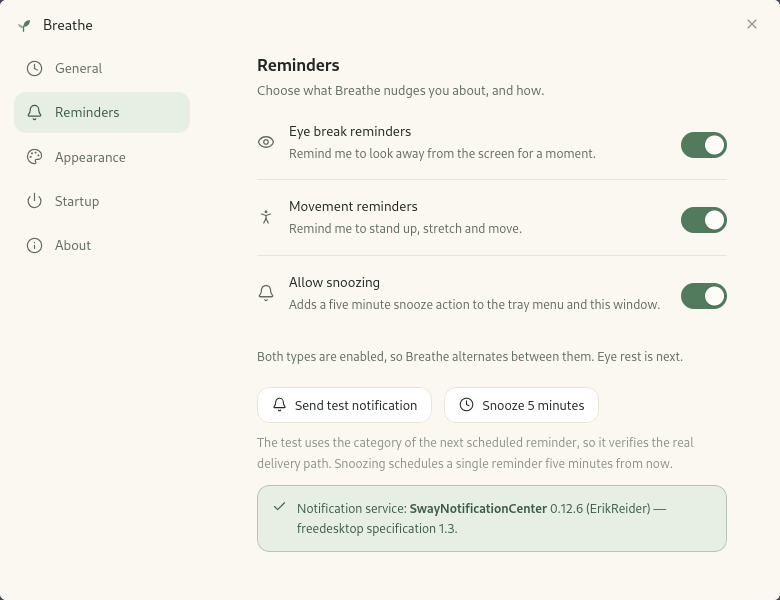

# Breathe

A calm, minimal desktop reminder for people who forget to move.

Breathe sits quietly in the background and nudges you — alternately to rest
your eyes and to stand up and move — on an interval you choose. It never locks
the screen, never steals focus, and never opens a window on top of your work: a
reminder is a desktop notification, and nothing else.



## Website and downloads

The landing page source lives in [`website/`](website/) and is built for
`https://usfmah.github.io/breathe/` by
[`.github/workflows/pages.yml`](.github/workflows/pages.yml). GitHub Pages must
be enabled with **Settings → Pages → Source: GitHub Actions** before the first
deployment; see [`docs/WEBSITE.md`](docs/WEBSITE.md).

The page reads the latest stable release from GitHub's public Releases API at
runtime. Downloads appear only when the exact RPM, DEB, AppImage, NSIS, source,
or AUR filename is present in that release. If the API is unavailable, the page
shows a GitHub Releases fallback instead of linking to an unverified file.

## What it does

- **Circular countdown** with the next reminder in `MM:SS`, using muted sage and
  warm cream in light mode, and a soft charcoal version in dark mode.
- **Follow the system theme**, or pin Light / Dark in Settings → Appearance.
- **Reminder interval** of 20, 30, 45 (default) or 60 minutes, changeable from
  the main window or Settings → General.
- **Eye-rest and movement reminders.** When both are on, Breathe alternates.
  With one on, it always uses that one. With both off, nothing is scheduled.
- **Pause / Resume.** Pausing freezes the remaining time; resuming continues it.
- **Optional 5-minute snooze** from the tray or Settings → Reminders.
- **Hides instead of quitting.** Closing the window keeps the scheduler alive.
  Quit from the tray menu or Settings → About.
- **Start with your session.** XDG autostart on Linux; the per-user Windows Run
  key on Windows.
- A **system-tray menu** on desktops with a StatusNotifierItem host (Linux) or
  in the Windows notification area.

## Settings

Settings are split into General, Reminders, Appearance, Startup and About.
Notification availability is reported per platform: a real D-Bus round trip on
Linux and the native toast platform on Windows. On Linux, this means the
Reminders panel can tell you whether the desktop will actually show a reminder;
on Windows, Focus Assist and notification settings can still suppress a toast.



The interface uses React 19, Tailwind CSS 4 and `lucide-react` for its icon set
(with a bespoke leaf mark); see [`docs/DEVELOPMENT.md`](docs/DEVELOPMENT.md).

## Supported platforms

Breathe is built for **Fedora Linux x86_64** and **Windows 10/11 x64**. It also
publishes Debian/Ubuntu DEB packages, an AppImage, and Arch Linux packaging
files. Linux is not a single platform: notifications, tray icons and autostart
all depend on the desktop services that are actually running.

| Platform | Package | Verification status |
| --- | --- | --- |
| Fedora 44 x86_64, niri 26.04, Wayland | RPM | App built and run from source on this host; the RPM was installed and launched under Xvfb in a Fedora 44 container. Oldest Fedora actually tested: **Fedora 44**. |
| Fedora Workstation / KDE | RPM | The code uses XDG conventions and standard freedesktop services, but these sessions have not been individually re-verified for this release. |
| Ubuntu 22.04 x86_64 | DEB / AppImage | An Ubuntu 22.04-built DEB and AppImage both installed and/or launched under Xvfb. This is the oldest glibc runtime tested (2.35). |
| Ubuntu 24.04 x86_64 | DEB | An Ubuntu 22.04-built DEB installed and launched under Xvfb; the local Fedora-built DEB also launched. The release workflow is configured to repeat this check for the tagged artifact. |
| Debian 12 x86_64 | DEB | An Ubuntu 22.04-built DEB installed and launched under Xvfb. The local Fedora-built DEB installs but cannot launch because it needs glibc 2.39 (Debian 12 has 2.36). |
| Linux x86_64 | AppImage | An Ubuntu 22.04-built AppImage launched under Xvfb on Ubuntu 22.04, Ubuntu 24.04 and Fedora 44. A Fedora-built local AppImage launched on Fedora 44 but is not portable to older glibc. The release workflow is configured to repeat the checks for the tagged artifact. |
| Arch Linux x86_64 | AUR source package | `PKGBUILD`/`.SRCINFO` are validated with `makepkg --printsrcinfo` in an Arch container. A full `makepkg -si` build is not yet exercised in this environment, and the package is **not yet published to the AUR**. |
| Windows 10/11 x64 | NSIS | CI built the MSVC target and passed the silent install/uninstall and autostart-cleanup smoke test on Windows Server 2022 on 2026-10-19. Toast delivery, tray interaction, autostart after reboot, and DPI behaviour still require manual testing on Windows 10/11. |

**Do not read this table as a claim of universal Linux compatibility.** The
native RPM and DEB are the recommended Linux packages. The AppImage is a
convenience artifact, not a substitute for a distro package.

## Install

### Fedora / RPM

```bash
sudo dnf install ./Breathe-0.1.0-1.x86_64.rpm
breathe
```

The RPM declares its runtime dependencies, so `dnf` installs GTK 3, WebKitGTK
4.1, librsvg, libappindicator, glibc and the C++ runtime if they are missing.
No Node.js, Rust, npm or Cargo is needed on the user's machine.

### Debian / Ubuntu

```bash
sudo apt install ./Breathe_0.1.0_amd64.deb
breathe
```

The DEB declares `libwebkit2gtk-4.1-0`, `libgtk-3-0`, `libappindicator3-1`,
`librsvg2-2`, `libc6`, `libgcc-s1` and `libstdc++6`. On distributions that use
the `t64` transition, the normal package dependencies pull in the renamed
libraries.

### AppImage

```bash
chmod +x Breathe_0.1.0_amd64.AppImage
./Breathe_0.1.0_amd64.AppImage
```

The release AppImage is built on Ubuntu 22.04. It therefore needs **glibc 2.35
or newer** and the usual desktop GTK/WebKitGTK base libraries. It bundles the
application and most of WebKitGTK/GTK, but it is not a fully static container:
minimal systems may still need packages such as `libfribidi0` and
`libfontconfig1`. Minimal containers are not the target; a normal desktop is.

If FUSE 2 is not installed, use the extraction fallback:

```bash
./Breathe_0.1.0_amd64.AppImage --appimage-extract-and-run
```

### Arch Linux / AUR

The release page includes `Breathe-<version>-aur.tar.gz`, containing a source
`PKGBUILD` and `.SRCINFO` with a pinned checksum:

```bash
mkdir breathe-aur
tar -xzf Breathe-0.1.0-aur.tar.gz -C breathe-aur
cd breathe-aur
makepkg -si
```

The repository also contains the template at [`packaging/aur/`](packaging/aur/).
Its checksum is intentionally `SKIP` until the release workflow renders the
pinned release copy. Prefer the release tarball for installation.

The AUR build assumes `base-devel` and declares `rust`, `cargo`, `nodejs`, `npm`,
`pkgconf`, `git`, `webkit2gtk-4.1`, `gtk3`, `libappindicator` and `librsvg`.
The resulting package runs without the build toolchain.

### Windows 10/11 x64

Run `Breathe_0.1.0_x64-setup.exe` and follow the installer. It is a per-user
NSIS install, so it does **not** need administrator rights, and it creates a
Start Menu shortcut.

- WebView2 is required at runtime. If it is missing, the installer downloads the
  Microsoft bootstrapper, so the first install needs an internet connection.
- The Visual C++ runtime is bundled with the installer.
- The installer is **not code-signed**, so Windows SmartScreen may show an
  "Unknown publisher" warning. Verify the download source before running it.
- No Node.js, Rust, npm or Cargo is required.

See [`docs/WINDOWS.md`](docs/WINDOWS.md) for Windows-specific behaviour and the
manual verification checklist.

## Runtime requirements

### Linux

- A **notification daemon** for reminders. Fedora Workstation and most desktop
  spins ship one. On a minimal niri/sway setup install `swaynotificationcenter`
  (swaync), `dunst`, `mako`, or an equivalent.
- A **StatusNotifierItem host** for the tray icon: waybar's `tray` module, a KDE
  panel, the GNOME AppIndicator extension, or another SNI host. Without one the
  app still works; you just lose the tray menu.
- An XDG autostart implementation if you want "Start with user session" to take
  effect. Some minimal sessions never read `~/.config/autostart`; the Startup
  panel reports when that is the case and suggests adding a compositor-specific
  startup command instead.
- GTK 3, WebKitGTK 4.1, librsvg and libappindicator. The native packages declare
  these; if you run the AppImage or a local build, your desktop normally already
  has them.

### Windows

- Windows 10 or Windows 11, x64.
- WebView2 Evergreen Runtime (the installer can fetch it if it is missing).
- Notification settings that allow Breathe to show toasts. Focus Assist / Do Not
  Disturb can suppress them.

## Run from source

### Linux

Install the build dependencies (Fedora names; Debian/Ubuntu equivalents are in
[`docs/LINUX_PACKAGING.md`](docs/LINUX_PACKAGING.md)):

```bash
sudo dnf install \
  webkit2gtk4.1-devel gtk3-devel libappindicator-gtk3-devel \
  librsvg2-devel openssl-devel libxdo-devel rpm-build @development-tools
```

Then:

```bash
npm ci
npm run tauri dev
```

`npm run dev` alone opens the interface in a browser with a mocked backend —
useful for layout work, but it cannot send real notifications or touch the
scheduler.

### Windows

Install Node.js 24, the Rust MSVC toolchain (1.96.0 is what CI uses), the Visual
Studio Build Tools "Desktop development with C++" workload, and the WebView2
runtime. Then:

```powershell
npm ci
npm run tauri dev
```

See [`docs/WINDOWS.md`](docs/WINDOWS.md) for the full setup.

## Build packages

```bash
# Linux: RPM, DEB and AppImage
npm run tauri build -- --bundles rpm,deb,appimage -- --locked

# Windows: NSIS installer
npm run tauri build -- --bundles nsis -- --locked
```

The final `-- --locked` is forwarded by the Tauri CLI to Cargo. Tauri does not
expose a separate `--locked` option of its own.

Output locations:

| Artifact | Path |
| --- | --- |
| RPM | `src-tauri/target/release/bundle/rpm/Breathe-<version>-1.x86_64.rpm` |
| DEB | `src-tauri/target/release/bundle/deb/Breathe_<version>_amd64.deb` |
| AppImage | `src-tauri/target/release/bundle/appimage/Breathe_<version>_amd64.AppImage` |
| NSIS | `src-tauri/target/release/bundle/nsis/Breathe_<version>_x64-setup.exe` |

The Linux build is split into `src-tauri/tauri.linux.conf.json` and the Windows
build into `src-tauri/tauri.windows.conf.json`. The common configuration lives
in `src-tauri/tauri.conf.json`.

## Where things live

| What | Linux | Windows |
| --- | --- | --- |
| Settings | `~/.local/share/dev.breathe.app/settings.json` | `%APPDATA%\dev.breathe.app\settings.json` |
| Startup entry | `~/.config/autostart/Breathe.desktop` | `HKCU\Software\Microsoft\Windows\CurrentVersion\Run` |
| WebKit cache | `~/.local/share/dev.breathe.app/` | `%LOCALAPPDATA%\dev.breathe.app\` |

Settings survive restarts. The countdown deliberately does **not**: Breathe
never restores a stale deadline, so after a restart you always get a full
interval instead of a burst of reminders.

## Removing autostart

**Linux:** turn off Settings → Startup → *Start with user session*, or delete the
entry:

```bash
rm ~/.config/autostart/Breathe.desktop
```

If you added Breathe to `~/.config/niri/config.kdl` by hand, remove the matching
`spawn-at-startup` line as well.

**Windows:** turn off the same switch, or delete the per-user Run value:

```powershell
Remove-ItemProperty `
  -Path 'HKCU:\Software\Microsoft\Windows\CurrentVersion\Run' `
  -Name 'Breathe' `
  -ErrorAction SilentlyContinue
```

The NSIS uninstaller removes the application files, its shortcut, and a
`Breathe` value from the per-user Run key (except during an in-place update). If
you delete the install directory by hand instead of running the uninstaller,
remove the value with the command above.

## Testing

```bash
npm run typecheck   # strict TypeScript, app + config files
npm test            # app and website unit tests (Vitest)
npm run website:build  # website production build + type check
npm run website:check  # verify /breathe/ base path, assets and 404 page
cargo test --locked --manifest-path src-tauri/Cargo.toml   # scheduler, model, settings, platform helpers
npm run check:version  # package.json, package-lock.json, tauri.conf.json and Cargo.toml must agree
```

The Rust tests are platform-neutral, plus Linux- and Windows-specific unit tests
for notification and autostart reporting. They do **not** prove that a real
desktop will show a toast or that a Windows toast identity is correct.

CI runs the same checks on Linux and Windows, builds all packages, builds and
validates the website on Linux, and validates the AUR metadata. The release
workflow is configured to install and launch the RPM/DEB and AppImage under
Xvfb; it has not run yet. See
[`.github/workflows/ci.yml`](.github/workflows/ci.yml),
[`.github/workflows/release.yml`](.github/workflows/release.yml), and
[`.github/workflows/pages.yml`](.github/workflows/pages.yml).

The first CI run on `main` (2026-10-19) passed on Linux, Windows Server 2022 and
the Arch container. The Windows job built the NSIS installer and passed its
silent install/uninstall smoke test; the Linux job built the RPM, DEB and
AppImage but did not install them. Locally, an Ubuntu 22.04 build launched the
DEB on Ubuntu 22.04, Ubuntu 24.04 and Debian 12, and the AppImage on Ubuntu
22.04, Ubuntu 24.04 and Fedora 44.

The tag-only release workflow is **configured** to run these release checks
against the tag-built artifacts, not against the local packages:

| Artifact | Release smoke target |
| --- | --- |
| RPM | Fedora 44 container under Xvfb |
| DEB | Ubuntu 24.04 and Debian 12 containers under Xvfb |
| AppImage | Ubuntu 24.04 and Fedora 44 containers under Xvfb |
| NSIS | Windows Server 2022 installer/uninstaller smoke test |
| AUR metadata | `archlinux:base-devel` container (`makepkg --printsrcinfo`) |

Those release checks have not run yet. A successful release run is required
before treating the published artifacts or the landing-page download links as
verified.

## CI and releases

- **CI** runs on pushes to `main`, pull requests, and manual dispatch. It does
  not publish releases.
- **Release** runs on `v*` tags. It is configured to validate the tag against the
  version sources, build RPM/DEB/AppImage/NSIS, install and launch the Linux
  packages under Xvfb, and create or update a GitHub Release with stable
  filenames. It has not run yet.
- Release assets are attached to the GitHub Release; build artifacts are also
  available from the Actions run for a limited time.
- The release workflow uses the repository's `GITHUB_TOKEN`, not a personal
  access token, and requests `contents: write` only in the publish job.
- Re-running a failed release run is designed to be safe: the publish step
  edits the existing release and overwrites assets instead of creating
  duplicates.

The complete release procedure, version bump, tag commands and AUR submission
steps are in [`docs/RELEASE.md`](docs/RELEASE.md).

## Known limitations and manual testing

- **Linux is not universal.** The only Fedora version actually tested is Fedora
  44. Other distributions and desktop sessions may have different notification
  daemons, tray hosts or autostart behaviour.
- **Tray clicks on Linux.** Tauri never emits tray click events on Linux, so the
  menu opens on both left and right click and every action lives in the menu.
  This is a Tauri/AppIndicator limitation.
- **AppImage portability.** The AppImage is built on Ubuntu 22.04 and is
  documented as requiring glibc 2.35 or newer. An Ubuntu 22.04-built AppImage
  launched locally on Ubuntu 22.04, Ubuntu 24.04 and Fedora 44. A locally built
  AppImage on a newer distribution is only usable on distributions at least as
  new as the build host. It also relies on base desktop libraries that are not
  bundled.
- **Windows is covered by CI compilation and an installer smoke test, not by
  real-hardware use.** Toast delivery, Focus Assist, tray overflow, autostart
  after a reboot, DPI scaling, and interactive-uninstaller cleanup still need
  manual testing on Windows 10 and 11.
- **Windows toast identity in development.** The notification plugin sets the
  application identity only for installed builds, not when running from
  `target/debug` or `target/release`. Use the installed build when checking
  toast attribution.
- **Suspend detection is a heuristic.** A suspend shorter than about 5 seconds is
  treated as normal elapsed time; missed reminders are dropped rather than
  replayed.
- **The AUR package is validated, not fully built, in this environment.** A full
  `makepkg -si` run on Arch is still a manual release check, and the package is
  not yet published to the AUR. Use the release AUR tarball to build locally.

## Documentation

- [`docs/DEVELOPMENT.md`](docs/DEVELOPMENT.md) — architecture, scheduler policy,
  the IPC surface and platform code layout.
- [`docs/LINUX_PACKAGING.md`](docs/LINUX_PACKAGING.md) — RPM, DEB, AppImage and
  AUR details, runtime dependencies and tested distributions.
- [`docs/WINDOWS.md`](docs/WINDOWS.md) — Windows install, build, notification,
  tray and startup details.
- [`docs/RELEASE.md`](docs/RELEASE.md) — versioning, CI/release workflows, tag
  commands and artifact locations.
- [`docs/WEBSITE.md`](docs/WEBSITE.md) — landing-page development, GitHub Pages
  setup, base path and release-data behavior.
- [`docs/TROUBLESHOOTING.md`](docs/TROUBLESHOOTING.md) — notifications, tray,
  autostart, sleep/resume, AppImage and Windows problems.
- [`docs/ENVIRONMENT.md`](docs/ENVIRONMENT.md) — the Linux machine this project
  was built and verified on.

## License

MIT. See [`LICENSE`](LICENSE).
