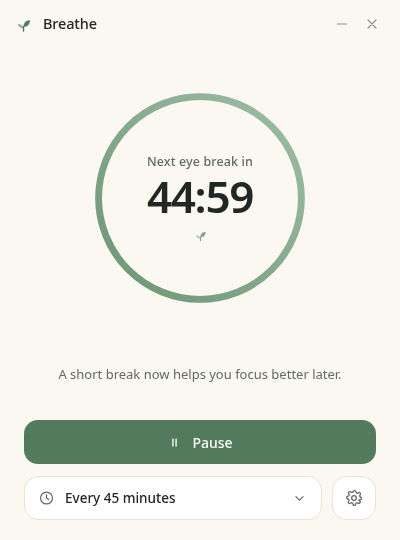

# Breathe

A calm desktop app that reminds you to rest your eyes and move. Reminders arrive
in a small Breathe popup with a soft chime; Breathe never locks your screen or
takes focus from your work.



## Install

Download the latest version from the [Breathe website](https://usfmah.github.io/breathe/)
or [GitHub Releases](https://github.com/usfmah/breathe/releases). Open a terminal
in the folder where you downloaded the file, then follow the instructions for
your system.

### Fedora

Download the RPM, then install and launch Breathe:

```bash
sudo dnf install ./Breathe-0.1.1-1.x86_64.rpm
breathe
```

### Ubuntu or Debian

Download the DEB, then install and launch Breathe:

```bash
sudo apt install ./Breathe_0.1.1_amd64.deb
breathe
```

### Other Linux distributions

The AppImage needs glibc 2.35 or newer and the usual desktop GTK/WebKit
libraries. Make it executable and run it:

```bash
chmod +x Breathe_0.1.1_amd64.AppImage
./Breathe_0.1.1_amd64.AppImage
```

If it reports that FUSE is missing, try:

```bash
./Breathe_0.1.1_amd64.AppImage --appimage-extract-and-run
```

### Arch Linux

The release includes build files, but Breathe is not published in the AUR yet.
Download `Breathe-0.1.1-aur.tar.gz`, extract it, and build the package:

```bash
mkdir breathe-aur
tar -xzf Breathe-0.1.1-aur.tar.gz -C breathe-aur
cd breathe-aur
makepkg -si
```

### Windows 10/11

Download and open `Breathe_0.1.1_x64-setup.exe`. It installs for your user and
does not need administrator rights. If WebView2 is missing, the installer needs
an internet connection to install it. The installer is signed with Authenticode,
but Windows may still show a SmartScreen prompt while the certificate builds
reputation.

## What Breathe does

- Alternates between eye-rest and movement reminders when both are enabled.
- Supports 20, 30, 45, or 60 minute intervals and pause/resume from the saved
  remaining time.
- When a reminder is due, Breathe waits for you: take a 3-minute break (the
  next countdown starts when it ends) or snooze for 10 minutes. It never
  restarts the countdown on its own.
- Includes light, dark, and system themes.
- Can start with your user session and keeps running when its window is closed.

## Supported platforms

Breathe supports Linux and Windows on x86_64, and macOS 11+ as a universal
(Apple silicon and Intel) app. The macOS build uses only public Apple APIs and
has been tested on a Mac; it is not in a stable release yet, so download it from
CI or build it from source (see [docs/MACOS.md](docs/MACOS.md)). Linux tray icons and reminders
depend on your desktop's tray host and notification service. Release packages
were smoke-tested on Fedora 44, Ubuntu 24.04, and Debian 12. The Windows
10 Pro x64 VM passed per-user installation, launch, Settings, and window-control
checks. Notifications, tray-menu actions, autostart, DPI, and Windows 11
hardware behavior still need testing.

## Run from source

Install Node.js 24, Rust, and the Tauri dependencies for your system (see the
[development guide](docs/DEVELOPMENT.md)), then run:

```bash
npm ci
npm run tauri dev
```

## More information

- [Linux package details](docs/LINUX_PACKAGING.md)
- [Windows setup and troubleshooting](docs/WINDOWS.md)
- [Development and architecture](docs/DEVELOPMENT.md)
- [Release process](docs/RELEASE.md)
- [Website](docs/WEBSITE.md)
- [Troubleshooting](docs/TROUBLESHOOTING.md)

## License

MIT. See [LICENSE](LICENSE).

## Credits

Maryam Medhat ([@maryamedhatt](https://github.com/maryamedhatt)) — Windows 11 testing and features reports.
Yasserr257 ([@Yasserr257](https://github.com/Yasserr257)) — Windows 11 testing and debugging.
